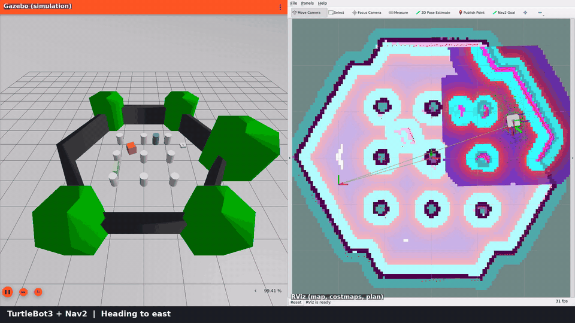
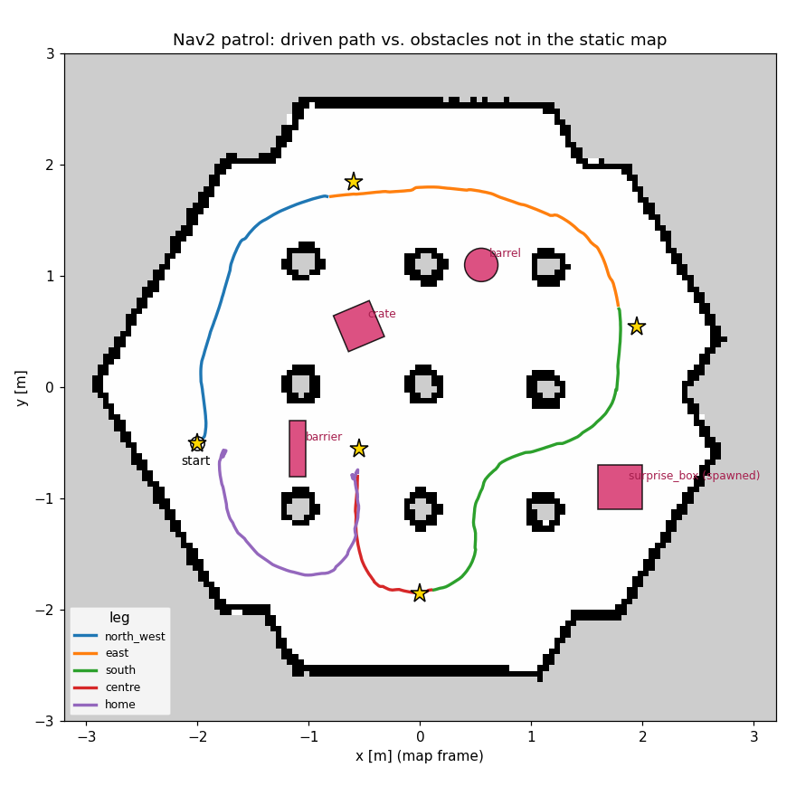

# TurtleBot3 + Nav2 autonomous navigation in Gazebo

A TurtleBot3 Waffle in **Gazebo Harmonic** uses the **ROS 2 Jazzy Navigation2 stack** to drive a
5-goal patrol through the TurtleBot3 world. Three obstacles that are **not in the static map** sit
on the routes the planner would otherwise take, and a "surprise" box is dropped onto the robot's
route mid-run. Nav2 only learns about them through the LiDAR, marks them in its costmaps, and plans
around them.

> **Project page:** open [`docs/index.html`](docs/index.html) in a browser (works offline from
> the cloned repo). It has an animated replay of the logged path with re-simulated LiDAR, an
> interactive architecture diagram, the video with chapters, and the experiment charts.
> `docs/index.html#replay=stock@24.5` jumps straight to the stock-params robot being stopped by
> `collision_monitor` in front of the surprise box.

> **Demo video (79 s):** [`media/demo.mp4`](media/demo.mp4): Gazebo on the left, RViz on the
> right, live caption at the bottom. Recorded with `./tools/record_demo.sh`.



*The surprise box (magenta, left) appears on the robot's route. The LiDAR marks it in the local
costmap (right), the green global plan swings west through the pillars, and the robot follows it.*



*Path driven in the recorded demo: 5/5 goals, 67.2 s, 0 recoveries. It never came closer than
0.09 m to any unmapped obstacle beyond its footprint. Magenta shapes are **not** in the map Nav2 was given. Stars
are goals.*

---

## What's in here

| Path | Purpose |
|---|---|
| `Dockerfile`, `docker/` | Reproducible ROS 2 Jazzy + Gazebo Harmonic + Nav2 image, GUI run script, shared GPU detection (`gpu_args.sh`) |
| `tb3_nav2_demo/launch/demo.launch.py` | Wraps the stock `nav2_bringup/tb3_simulation_launch.py` with this package's world, params and RViz config. Optionally starts the patrol |
| `tb3_nav2_demo/worlds/tb3_obstacles.sdf.xacro` | TurtleBot3 sandbox world plus 3 extra obstacles that are not in the map |
| `tb3_nav2_demo/config/nav2_params.yaml` | Nav2 params (stock + documented `[tuned]` changes) |
| `tb3_nav2_demo/config/nav2_params_stock.yaml` | Untouched upstream params, for A/B comparison |
| `tb3_nav2_demo/config/nav2_params_tuned_v1.yaml`, `nav2_params_exp_speed_only.yaml` | Intermediate configs used in the experiments, kept so every comparable run can be reproduced |
| `tb3_nav2_demo/config/waypoints.yaml` | Patrol route and the surprise-obstacle spec |
| `tb3_nav2_demo/scripts/patrol.py` | Sends goals with `nav2_simple_commander`, logs results, path and recoveries, spawns the surprise obstacle |
| `tb3_nav2_demo/scripts/plot_trajectory.py` | Plots the driven path over the map, computes clearance to every obstacle and the reaction (stall) time at the surprise box |
| `tb3_nav2_demo/rviz/` | `nav2_demo.rviz` (interactive, full panels) and `record.rviz` (clean layout for the video) |
| `tools/headless_test.sh` | End-to-end test without GUI. Exits non-zero if a goal fails or the robot touches an obstacle |
| `tools/record_demo.sh` | Records the demo video on a virtual display inside the container |
| `results/` | Logs, CSVs and plots from the experiment runs below |
| `media/` | Demo video, GIF, path log/plot and patrol summary of the recorded run |
| `docs/index.html`, `tools/build_page_data.py` | Project page; its data is regenerated from `results/` and `media/` |

No custom navigation algorithms. Planning, control, localisation and recovery are all stock Nav2
(NavFn planner, MPPI controller, AMCL, behaviour-tree navigator). The work here is integration,
configuration, test design and measurement.

## Stack

- ROS 2 **Jazzy** (LTS), Ubuntu 24.04 (in Docker)
- Gazebo **Harmonic** via `ros_gz`, robot and world from `nav2_minimal_tb3_sim`
- Nav2: `map_server` + `amcl` (localisation), `planner_server` (NavFn), `controller_server` (MPPI),
  `bt_navigator`, `behavior_server`, `velocity_smoother`, `collision_monitor`
- TurtleBot3 **Waffle** with a 360° LiDAR

```
Gazebo Harmonic ──(ros_gz_bridge: /scan /odom /tf /clock, cmd_vel)──► ROS 2
   ▲                                                                   │
   │ cmd_vel                    map_server (static map, no extra obstacles)
   │                            amcl ──► map→odom
   └── collision_monitor ◄── velocity_smoother ◄── controller_server (MPPI, local costmap: LiDAR voxel layer)
                                                         ▲
                                     bt_navigator ──► planner_server (NavFn, global costmap: static + LiDAR obstacle layer)
                                         ▲
                                   patrol.py (NavigateToPose goals)
```

## Quick start (Docker, any Linux with X11/XWayland)

```bash
git clone https://github.com/aPassie/turtlebot3-nav2-gazebo.git && cd turtlebot3-nav2-gazebo
docker build -t tb3-nav2 .        # ~5 GB image, 5-10 min the first time

# Full demo: Gazebo GUI + RViz, robot runs the patrol on its own
./docker/run.sh
```

`docker/run.sh` forwards X11 (XWayland works) and passes through Intel/AMD GPUs for hardware
OpenGL. If the NVIDIA Container Toolkit is installed it uses `--gpus all` instead (untested: my
machine didn't have the toolkit). `NO_GPU=1 ./docker/run.sh` forces software rendering. The
package is copied into the image, so **re-run `docker build` after editing params or scripts**.

Other ways to run it:

```bash
# Send goals yourself with "Nav2 Goal" in RViz (no patrol)
./docker/run.sh ros2 launch tb3_nav2_demo demo.launch.py patrol:=False

# Patrol several times (obstacles stay in the costmap between loops)
./docker/run.sh ros2 launch tb3_nav2_demo demo.launch.py loops:=3

# Compare against the untouched upstream parameters
./docker/run.sh ros2 launch tb3_nav2_demo demo.launch.py \
    params_file:=/ws/install/tb3_nav2_demo/share/tb3_nav2_demo/config/nav2_params_stock.yaml

# Headless end-to-end test + plot + clearance check  -> results/<tag>/
./tools/headless_test.sh tuned        # or: stock
# Record the demo video (no screen capture of your desktop needed) -> media/demo.mp4
./tools/record_demo.sh
```

### Native install (Ubuntu 24.04 + ROS 2 Jazzy)

Not tested by me (I used Docker). These steps mirror the Dockerfile.

```bash
source /opt/ros/jazzy/setup.bash
mkdir -p ~/tb3_ws/src && cp -r tb3_nav2_demo ~/tb3_ws/src/ && cd ~/tb3_ws
sudo apt install python3-rosdep python3-colcon-common-extensions
sudo rosdep init 2>/dev/null; rosdep update
rosdep install --from-paths src --ignore-src -y     # Nav2, nav2_minimal_tb3_sim, ros_gz, ...
# Work around the upstream mesh-path bug so RViz can draw the robot (see Problems #3)
(cd /opt/ros/jazzy/share/nav2_minimal_tb3_sim/models && \
  for f in turtlebot3_model/meshes/*.dae; do sudo ln -sf "$f" .; done)
colcon build && source install/setup.bash
ros2 launch tb3_nav2_demo demo.launch.py
```

## How the demo is set up

**Map vs. world.** Nav2 gets the stock `tb3_sandbox` map (hexagon walls, 3×3 pillars). The Gazebo
world adds a crate, a barrel and a barrier that are not in that map. Nav2 only finds out about
them through the LiDAR-fed `voxel_layer` (local costmap) and `obstacle_layer` (global costmap).

**Placement is data-driven.** Each static obstacle sits on the route the planner took for one leg
in an earlier run when that spot was free, so the robot has to detour (see Experiments, run 0 → 1).
They are usually already in the costmap when their leg starts (LiDAR range 3.5 m, obstacle marking
to 2.5 m), so the *first* plan avoids them. The surprise box is the real test of replanning mid-leg.

**Surprise obstacle.** On the `south` leg, `patrol.py` uses `ros_gz_sim create` to spawn a
0.4 m box on the robot's current route once the robot is within 1.2 m of it. The gaps either
side are narrower than the robot, so it has to turn away and reroute through the pillars.

**Patrol.** `start → north_west → east → south → centre → home`, one `NavigateToPose` goal at a
time. Each goal reports success/failure, duration and the number of recoveries.

## Experiments

**Runs 2–8 are reproducible** with `./tools/headless_test.sh <config>`, where the config is
`stock`, `tuned`, or one of the YAML files in `tb3_nav2_demo/config/`. Runs 0–1 used an earlier
obstacle layout and a timer trigger that only survive in their plots/log in `results/`. Metrics:

- **Clearance**: minimum distance between the robot footprint and any *unmapped* obstacle
  surface, from the logged path. Shown for Nav2's configured `robot_radius` (0.22 m) and a
  conservative 0.24 m (the Waffle's rear corner is ~0.238 m from `base_link`).
- **Stall**: time the robot sat almost still (< 0.05 m/s) between the surprise-box trigger and
  driving past the box.
- **CM**: how often `collision_monitor` had to step in ("Robot to approach …" in the log).

| Run | Change being tested | Config | Goals | Driving time | Recov. | Min clearance (0.22 / 0.24 m) | Stall | `south` leg | CM |
|---|---|---|---|---|---|---|---|---|---|
| 0 | First obstacle layout, timer-triggered box | stock | 5/5 | 78.3 s | 1 | +0.102 / – | n/a | – | – |
| 1 | Obstacles moved onto the planner's paths | stock | 5/5 | 51.1 s | 0 | +0.215\* / – | n/a | – | – |
| 2 | Box triggered by **proximity** | stock | 5/5 | 59.9 s | 0 | +0.114 / +0.094 | 2.1 s | 16.6 s | 1 |
| 4 | repeat of 2 | stock | 5/5 | 58.0 s | 0 | +0.124 / +0.104 | 1.6 s | 15.8 s | 1 |
| 3 | Real TB3 speed limits **+** 10 Hz local costmap | `tuned_v1` | 5/5 | 69.0 s | 0 | +0.096 / +0.076 | 0.5 s | 17.1 s | 0 |
| 5 | repeat of 3 | `tuned_v1` | 5/5 | 67.0 s | 0 | +0.107 / +0.087 | 0.5 s | 16.6 s | 0 |
| 6a | **+** 5 Hz global costmap | tuned (default) | 5/5 | 67.5 s | 0 | +0.120 / +0.100 | 0.0 s | 15.9 s | 0 |
| 6b | repeat of 6a | tuned | 5/5 | 68.6 s | 0 | +0.155 / +0.135 | 0.5 s | 16.2 s | 0 |
| demo | the recorded video run (GUI + RViz) | tuned | 5/5 | 67.2 s | 0 | +0.094 / +0.074 | 0.0 s | 15.7 s | – |
| 7a | **Only** the speed limits (isolation test) | `exp_speed_only` | 5/5 | 68.1 s | 0 | +0.135 / +0.115 | 0.0 s | 16.0 s | 0 |
| 7b | repeat of 7a | `exp_speed_only` | 5/5 | 66.6 s | 0 | +0.084 / +0.064 | 0.0 s | 15.3 s | 0 |
| 8 | Default config, **no GPU** (software rendering) | tuned | 5/5 | 67.4 s | 0 | +0.121 / +0.101 | 0.0 s | 15.7 s | 0 |

\* In run 1 the timer-spawned box landed where the robot never went, so this large clearance
means the test was broken, not that navigation improved. The demo's patrol log wasn't kept (its
summary is in `media/demo_patrol_summary.txt`), so its CM count is unknown.

**What I learned from each step**

- **Run 0, the obstacles weren't in the way.** I first placed obstacles in the "corridors"
  between the walls and pillars. The plot showed NavFn takes the shortest route *between* the
  pillars, so 3 of 4 obstacles were never closer than 0.4 m to the path. The barrel was the
  exception: MPPI got stuck next to it ("Failed to make progress"), a recovery ran, and the leg
  took 33 s. I moved every obstacle onto the routes from that run.
- **Run 1, a timer is the wrong trigger.** Without the old east barrier, the robot took a
  different route on the `south` leg, so the box spawned 6 s into the leg landed on a route it
  never used. I replaced the timer with a proximity trigger. From run 2 on, the box appears about
  1 m ahead of the robot.
- **Runs 2 & 4, what the stall actually is.** With stock params the robot stops ~0.55 m short of
  the box for 1.6–2.1 s. In both runs the log shows, 0.9 s after the spawn,
  `collision_monitor: Robot to approach for 1.2 seconds away from collision` followed by
  `controller_server: Optimizer fail to compute path`. The `FootprintApproach` polygon slows the
  robot so it can't collide within 1.2 s. At the stock 0.5 m/s that's a ~0.6 m look-ahead, which
  matches the stopping distance. The last-line safety layer, not the planner, is what stops the
  robot.
- **Runs 3–6, a confounded experiment.** I changed the speed limits to the real Waffle's
  0.26 m/s, *and* raised the local costmap to 10 Hz, *and* later raised the global costmap to
  5 Hz. The stall disappeared, and I first credited the 5 Hz global costmap with rerouting ~1 s
  sooner. An independent review of the repo pointed out the confound, and that the simulated
  LiDAR only publishes at 5 Hz, so a 10 Hz local costmap can't see anything new.
- **Run 7, isolating the cause.** Changing *only* the speed limits gives stall 0.0 / 0.0 s and
  zero `collision_monitor` interventions. At 0.26 m/s the 1.2 s horizon is only ~0.31 m, so MPPI
  steers away from the box before the safety layer has to act. **The speed limit explains the
  whole improvement.** Neither costmap-rate change has an effect I can distinguish from
  run-to-run noise (`south` leg 15.3–17.1 s across all non-stock runs). My earlier "~1 s sooner"
  claim doesn't survive this comparison.
- **Clearance never depended on speed.** It stayed in the same +0.08 to +0.16 m band for every
  config. The closest approach happens while the robot drives the new route past the box's
  corner, so it is set by the inflation layer (0.7 m, scaling 3.0, left at stock) and the route.
- **Run 8, no GPU.** The default config with no GPU device in the container (Mesa software
  rendering) also passes, so the setup doesn't need hardware acceleration.

**The final config** differs from upstream in what's marked `[tuned]`
(`diff tb3_nav2_demo/config/nav2_params_stock.yaml tb3_nav2_demo/config/nav2_params.yaml`):

| Parameter | Stock | Tuned | Evidence |
|---|---|---|---|
| MPPI `vx_max` / `vx_min` / `wz_max` | 0.5 / −0.35 / 1.9 | 0.26 / −0.26 / 1.82 | Real Waffle limits. Removes the collision-monitor stops (runs 2/4 vs 7) |
| `velocity_smoother` max/min velocity | ±0.5, ±2.0 | ±0.26, ±1.82 | Same limits after smoothing |
| Local costmap `update_frequency` | 5 Hz | 10 Hz | **No measurable effect.** LiDAR is 5 Hz |
| Global costmap `update_frequency` | 1 Hz | 5 Hz | **No measurable effect** beyond noise (run 7 vs 6) |
| AMCL `set_initial_pose` | off | on, at the spawn pose | No manual "2D Pose Estimate" needed |

The two costmap-rate changes are harmless but not justified by the data. They stay in the default
only because the recorded demo and runs 6/8 used them. What I'd ship is
`nav2_params_exp_speed_only.yaml` plus the initial pose.

### How much to trust these numbers

- n = 2–4 runs per config. Differences of about a second in leg time are within noise.
- Poses come from Nav2 feedback, i.e. the AMCL estimate, not Gazebo ground truth. AMCL
  corrections make the logged pose jump by up to ~5 cm: over 0.5 s windows it implies up to
  0.35 m/s against a 0.26 m/s cap. The tightest clearances (+0.06 to +0.10 m) are only 1–2× that
  uncertainty, so "no contact" rests on this plus zero recoveries or stuck events in every run
  after run 0, not on the clearance number alone.
- Times are wall-clock. The simulation ran at ~0.97–1.0× real time.
- The stall is measured from the trigger, which includes ~1 s of spawn latency (`ros2 run ros_gz_sim create`).

### Known limitations / what I'd do next

- Log Gazebo ground-truth pose (bridge `/model/.../pose`) and use `navigation_time` (sim time) for durations.
- `vx_min = -0.26` lets the robot reverse as fast as it drives forward, and the acceleration limits
  (smoother 2.5 m/s², MPPI 3.0) aren't matched to the hardware. I'd tighten both, and use the
  real footprint polygon instead of `robot_radius`.
- The video sends goals with `nav2_simple_commander`. Clicking "Nav2 Goal" in RViz works
  (`patrol:=False`), but it isn't in the recording.
- The initial pose is set by both AMCL params and `patrol.py`, which sometimes produces harmless
  "Failed to transform initial pose" warnings at start-up.

## Problems I hit and how I fixed them

1. **Gazebo segfaulted on start (hybrid AMD + NVIDIA laptop, no NVIDIA Container Toolkit).**
   With all of `/dev/dri` passed in, EGL picked the NVIDIA render node first. Mesa has no driver
   for it, so Ogre2 failed ("Failed to create dummy render window") and `gz sim` crashed. That
   left no LiDAR and no AMCL pose, and the patrol waited forever. I traced it with `eglinfo` and
   `/sys/class/drm/*/device/driver`. The run scripts (`docker/gpu_args.sh`) now pass only
   Mesa-capable DRM nodes, and the container gets hardware rendering on the iGPU (AMD Radeon 780M,
   radeonsi). With `NO_GPU=1` it falls back to software rendering (verified, run 8). If the NVIDIA
   runtime is installed it uses `--gpus all` instead (untested: no toolkit on my machine).
2. **Test harness hung after a successful run.** Two bash bugs: a regex that didn't match the
   log format (`]:   5/5` vs. `] 5/5`), and `kill -INT` on a background job. Non-interactive
   bash starts background jobs with SIGINT ignored, so the launch never exited. Fixed with a
   correct regex and SIGTERM.
3. **RViz couldn't show the robot.** Upstream `nav2_minimal_tb3_sim`'s URDF references
   `package://nav2_minimal_tb3_sim/models/<mesh>.dae`, but the meshes are installed under
   `models/turtlebot3_model/meshes/`. Also, the stock RViz config subscribes to the latched
   `/robot_description` with Volatile QoS, so it never receives it. The Dockerfile symlinks the
   meshes, and the RViz configs use Transient Local.
4. **"Goal SUCCEEDED" isn't proof of obstacle avoidance.** The first runs reported 5/5, but only
   the trajectory plot showed the obstacles weren't actually being tested. That's why the repo
   logs the driven path and checks clearance automatically.
5. **Recording on Wayland (niri).** Rather than depend on the host compositor, the recorder runs
   Gazebo + RViz on Xvfb inside the container, tiles them with `xdotool`, and captures with
   ffmpeg plus a caption bar that follows the patrol log. First take: Gazebo's inspector panels
   and RViz's docks covered half the screen, and the map wasn't visible. Fixes: a `<gui>` block in
   the world with a fixed camera (setting it via `/gui/move_to/pose` didn't take effect), and an
   RViz layout without panels (the `Hide Dock` flags are overridden by the saved window state).

6. **My own conclusions needed correcting, twice.** I first wrote that the closest approach to
   the surprise box happens "the instant it appears". The speed profile showed it comes 5–6 s
   later. Then I credited the 5 Hz global costmap with faster rerouting. The isolation run
   (run 7) showed the speed limit alone explains it, and the log showed the stock-params stall is
   a `collision_monitor` intervention. Both corrections are in the table above. The lesson I took:
   change one variable at a time, and read the logs before explaining a number.

## Credits

Built on [Nav2](https://docs.nav2.org/) (`nav2_bringup`, `nav2_minimal_tb3_sim`,
`nav2_simple_commander`), [TurtleBot3](https://emanual.robotis.com/docs/en/platform/turtlebot3/)
models by ROBOTIS, and [Gazebo](https://gazebosim.org/). The map, robot model and base world come
from those packages unchanged. The world file is derived from `nav2_minimal_tb3_sim`'s
`tb3_sandbox.sdf.xacro` (Apache-2.0). This repo is Apache-2.0 too (see `LICENSE`).
